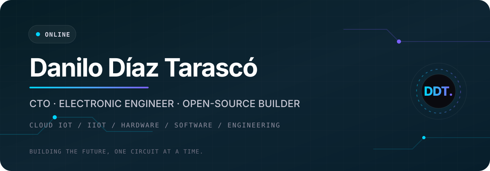

<div align="center">
  
</div>

<p align="center">
  <a href="https://ddtdanilo.github.io"><strong>Portfolio</strong></a>
  ·
  <a href="#selected-work"><strong>Selected work</strong></a>
  ·
  <a href="https://www.linkedin.com/in/ddtdanilo"><strong>LinkedIn</strong></a>
  ·
  <a href="https://www.youtube.com/ddtdanilo"><strong>YouTube</strong></a>
</p>

<p align="center">
  <a href="https://ddtdanilo.github.io"></a>
  <a href="https://www.linkedin.com/in/ddtdanilo"></a>
  
</p>

## Hello, I am Danilo

I am **Danilo Díaz Tarascó**, a CTO and electronic engineer working where hardware,
cloud software, and industrial operations meet. For more than ten years, I have
helped turn technical ideas into dependable products—from schematics and embedded
firmware to serverless platforms and engineering teams.

I believe the most useful technology emerges when art, science, and disciplined
engineering are allowed to reinforce one another. My work is guided by one simple
idea:

> **Build the future, one circuit at a time.**

<table>
  <tr>
    <td width="25%" align="center"><strong>Cloud IoT / IIoT</strong><br><sub>Telemetry, device fleets, FOTA, and serverless systems</sub></td>
    <td width="25%" align="center"><strong>Electronics</strong><br><sub>Power conversion, PCB design, IPC practice, and manufacturing</sub></td>
    <td width="25%" align="center"><strong>Embedded + Software</strong><br><sub>Python, C/C++, firmware, APIs, automation, and infrastructure</sub></td>
    <td width="25%" align="center"><strong>Technical Leadership</strong><br><sub>Product strategy, cross-functional teams, and engineering operations</sub></td>
  </tr>
</table>

## What I am building

- Leading technical strategy and IIoT engineering as CTO at
  [Sento IoT+Electronics Hub](https://sento.com.co).
- Creating production-minded tools that connect physical devices to secure,
  observable cloud systems.
- Maintaining open hardware and Python projects with reproducible releases,
  automated quality gates, and documentation designed for real users.
- Exploring AI-augmented engineering workflows while keeping human judgment,
  privacy, and verification at the center.

## Selected work

| Project | What it does | Focus |
| --- | --- | --- |
| [OpenAI Document Analyzer](https://github.com/ddtdanilo/OpenAI-Document-Analyzer) | A privacy-conscious Python CLI and library for analyzing TXT, Markdown, and PDF documents with OpenAI's Responses API. | Python · AI · document workflows |
| [Personal Altium Library](https://github.com/ddtdanilo/Personal-Altium-Library) | A curated, integrity-checked collection of schematic symbols and PCB footprints built from professional hardware work. | Altium · PCB · open hardware |
| [UT383BT Lux BLE](https://github.com/ddtdanilo/ut383bt-lux-ble-python) | A tested Python library and CLI for discovering, reading, and logging UNI-T UT383BT measurements over Bluetooth Low Energy. | Python · BLE · instrumentation |
| [Telemetry System](https://github.com/X-Sub/Telemetry-System) | The preserved engineering archive and modern protocol tools for an award-recognized underwater ROV telemetry thesis. | Telemetry · embedded · research |
| [Fuzzy Naked Mega](https://github.com/ddtdanilo/Fuzzy-Naked-Mega) | An open Arduino-compatible ATmega2560 board created for makers, educators, and embedded prototyping. | Arduino · PCB · open hardware |
| [vcpkg contribution](https://github.com/microsoft/vcpkg/pull/50323) | The `ddtdanilo-lmdb-wrapper` port, merged into Microsoft's cross-platform C/C++ package manager. | C/C++ · package engineering |

## Engineering toolkit

<p>
  
  
  
  
  
  
  
  
  
  
  
</p>

My daily work spans system architecture, serverless APIs, Infrastructure as Code,
embedded Linux, MicroPython, wireless protocols, test automation, PCB development,
power electronics, and design for manufacturing. Tools change; reliable interfaces,
clear evidence, and maintainable systems remain.

## How I work

```text
observe → model → prototype → measure → document → automate → improve
```

- **Systems before silos.** Hardware, firmware, cloud, and operations are one
  product with shared constraints.
- **Evidence before confidence.** Tests, measurements, design reviews, and
  traceable decisions make ambitious work safe to ship.
- **Documentation is part of the interface.** A project is not finished until
  another person can understand, operate, and extend it.
- **Open source is a practice.** Small, reviewable changes and respectful
  collaboration make useful work last.

## Beyond the repository

I am based in Medellín, Colombia, and collaborate internationally in English and
Spanish. For a fuller career timeline, consulting information, and the visual
version of this story, visit [my portfolio](https://ddtdanilo.github.io).

<p align="center">
  <a href="https://ddtdanilo.github.io">Website</a>
  ·
  <a href="https://www.linkedin.com/in/ddtdanilo">Professional profile</a>
  ·
  <a href="https://www.youtube.com/ddtdanilo">Videos</a>
</p>

<p align="center">
  <sub>Designed and maintained by Danilo Díaz Tarascó · Medellín, Colombia</sub>
</p>
